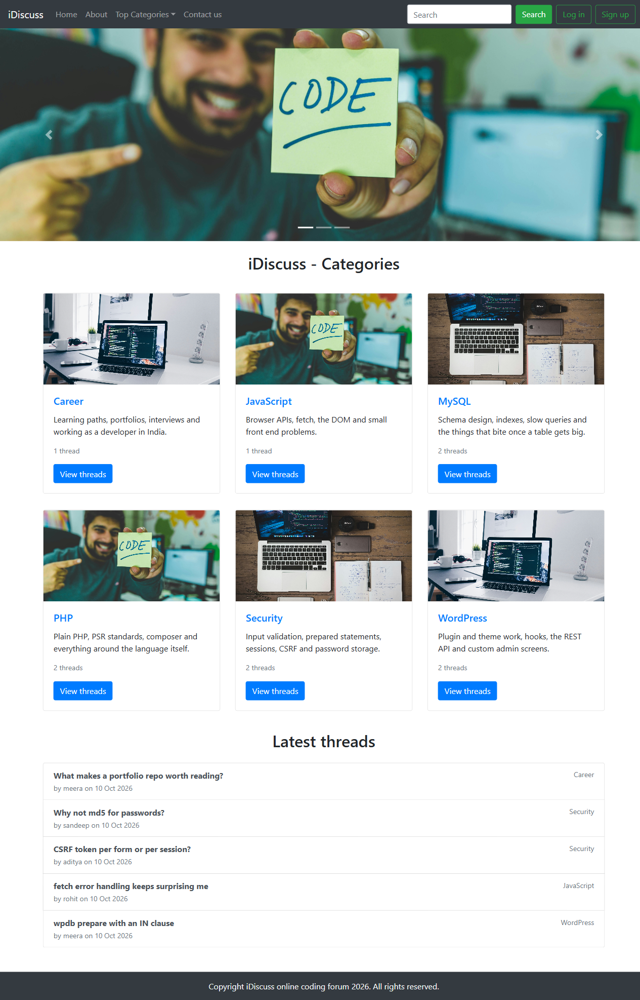
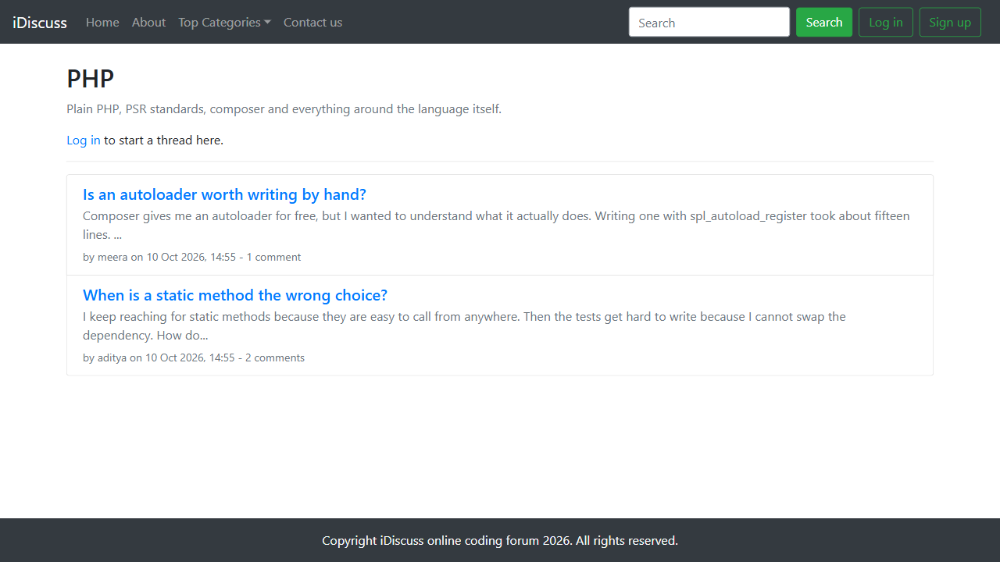
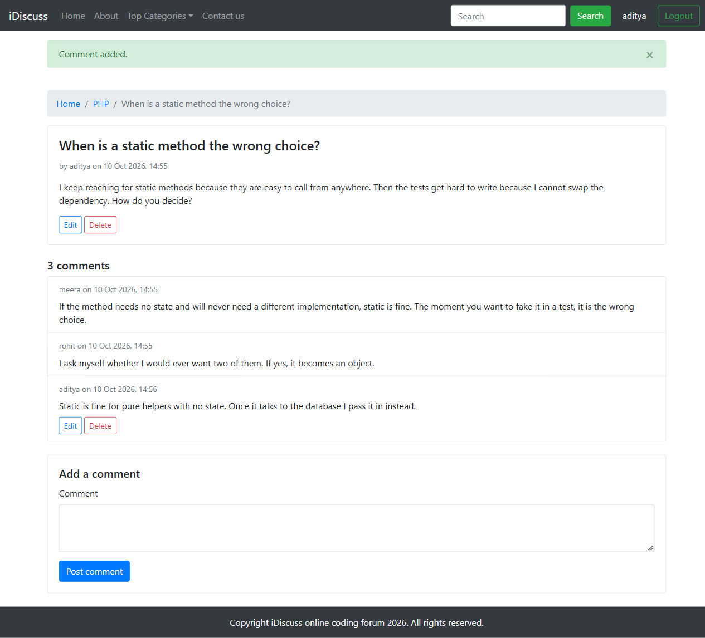
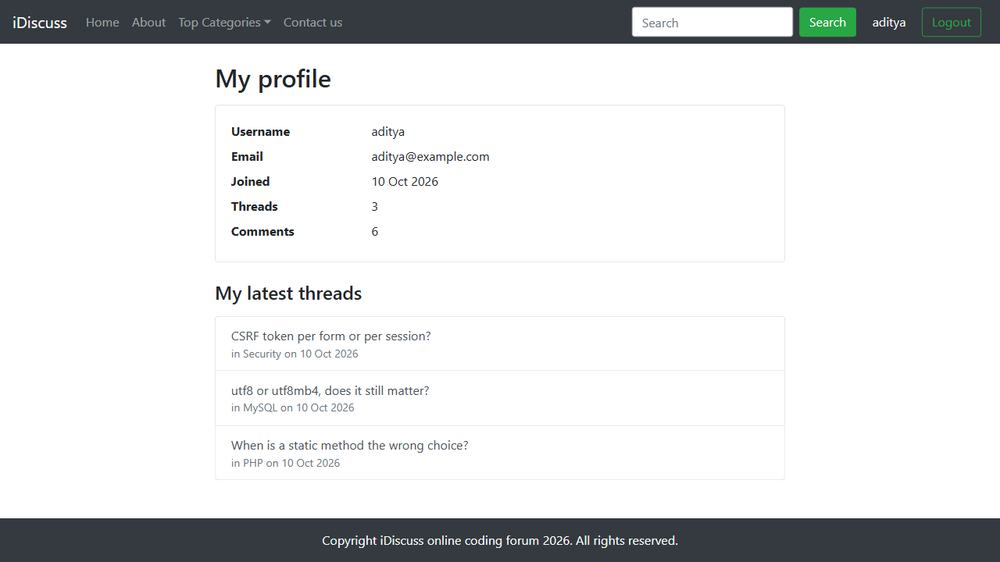

# iDiscuss

A coding discussion forum I built in PHP and MySQL while learning how a real multi-page app fits together: sign up and login, sessions, forms, and a database behind it.

Users browse categories, open a thread, and read the comments. After signing up they can start threads, comment, edit or delete their own posts, search, and see their own activity on a profile page. Passwords are hashed, every query is prepared, every form has a CSRF token, and repeated failed logins are slowed down.

## Run it locally

1. Create a database called `forum_website` and import `database/schema.sql`, then `database/seed.sql` for demo data (every demo account uses the password `demo1234`).
2. Copy `.env.example` to `.env` and put your database details in it.
3. Run `php -S localhost:8000 -t public` and open http://localhost:8000.

Tests: `composer install`, then `vendor/bin/phpunit`.
